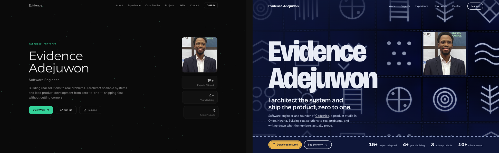
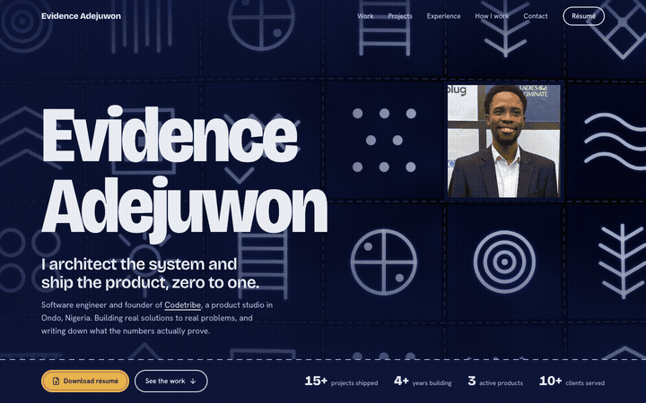

# loom

**A design workflow for sites built with AI.** loom helps your coding agent (Claude Code, Cursor, Codex or Antigravity) design websites that don't all look the same, checks them the way a visitor sees them, and learns from every review so the next project starts better.

It layers on [impeccable](https://github.com/pbakaus/impeccable), which handles design directions, craft rules and independent review. loom adds the evidence around it: honest screenshots, a fast read of an existing project, safe previews, and memory.

```sh
curl -fsSL https://raw.githubusercontent.com/evidence-codes/loom/main/install.sh | sh
```

Then, in your coding agent: *"Use loom to redesign my landing page."* Or in a terminal, just type `loom`.

## Before and now

A portfolio redesigned with loom, both versions captured by `loom capture`. Before: the dark card-grid look most AI-built sites share. Now: a direction chosen from distinct options and built to pass an independent review. The hero is live WebGL.



<p align="center"></p>

Live at [evidence.codetribehq.com](https://evidence.codetribehq.com). Another build: [Margin](https://margin-notebook.vercel.app), a concept product page.

## Why

- **AI-built sites converge on one look:** dark gradients, card grids, a glowing accent. The workflow commits each product to a distinct, reasoned direction instead.
- **Models grade their own work too kindly.** An independent reviewer working from real screenshots catches what the builder misses: fonts that never load, animations that break under reduced motion, layouts that collide on phones.
- **Screenshots usually lie.** Heroes get stretched, "phone" widths are faked, animations are caught halfway. loom captures what visitors actually see and tells you when a capture can't be trusted.
- **Inheriting a site starts with guesswork.** `loom adopt` shows in about a minute what the design really is, what's broken, and what's dead code.
- **It improves with use.** Mistakes a review catches become house rules and automatic checks.

## What you need

- macOS or Linux, [Node.js](https://nodejs.org) 22 or newer, and Google Chrome or Chromium.
- A coding agent for the full workflow: [Claude Code](https://claude.com/claude-code), [Cursor](https://cursor.com), [Codex](https://developers.openai.com/codex) or [Antigravity](https://antigravity.google). The CLI works on its own.

The installer checks all of this and says in plain English what's missing.

## Install

```sh
curl -fsSL https://raw.githubusercontent.com/evidence-codes/loom/main/install.sh | sh
```

The installer:

- links the `loom` command into `~/.local/bin`, with nothing installed system-wide and no npm;
- loads the starter house rules;
- adds the Claude Code plugin;
- adds loom's skills to Cursor, Codex and Antigravity, if they're on the machine;
- offers to install impeccable into each of them.

It's safe to run again. To do the steps by hand:

```sh
git clone https://github.com/evidence-codes/loom && cd loom && sh install.sh
# or just the Claude Code plugin:
claude plugin marketplace add evidence-codes/loom && claude plugin install loom@loom
# or just the skills for other agents (add --project . to put them in one repo):
loom agents install --agents cursor,codex,antigravity
loom setup --agents cursor,codex,antigravity
```

To uninstall: `claude plugin uninstall loom@loom`, delete the `loom-*` skill folders listed by `loom agents`, and `rm ~/.local/bin/loom`.

### Where loom goes in each agent

| Agent | loom's skills | impeccable |
|---|---|---|
| Claude Code | the `loom` plugin | the `impeccable` plugin, with its hooks |
| Cursor | `~/.cursor/skills/loom-*` | `~/.cursor/skills/impeccable`, reviewer and documenter in `~/.cursor/agents` |
| Codex | `$CODEX_HOME/skills/loom-*` (`~/.codex/skills`) | `~/.codex/skills/impeccable`, reviewer and documenter inside it |
| Antigravity | `~/.gemini/config/skills/loom-*` | `~/.gemini/config/skills/impeccable` |

With `--project <dir>` the skills go in that repo's `.cursor/skills`, `.agents/skills` or `.agent/skills` instead, so a team gets them by cloning. loom only ever replaces folders it wrote itself.

**What differs outside Claude Code.** The whole workflow runs in all four. impeccable's hooks, which run its detector after each edit, are per project in the other agents and aren't added. impeccable ships no reviewer agent for Antigravity, so there the finish review is a separate pass in the same session rather than a fresh agent, and the hand-off says so.

## Use it

**In your coding agent**, ask in plain words, or use the skills directly:

| Ask | Claude Code | Cursor, Codex, Antigravity |
|---|---|---|
| "Use loom to redesign / build / take over my site" | `/loom:workflow` | `loom-workflow` |
| "Check my site's design" | `/loom:adopt` | `loom-adopt` |
| "Take review screenshots" | `/loom:capture` | `loom-capture` |
| "Remember this for next time" | `/loom:learn` | `loom-learn` |

`loom-workflow` is the whole process, from first look to documented ship. In Cursor type `/loom-workflow`, in Codex `$loom-workflow`; Antigravity picks the skill from what you ask.

**In a terminal**, `loom` on its own opens a guided menu. The commands:

```sh
loom preview ./my-site --open        # run it safely, open the link
loom preview ./my-site --capture     # plus review screenshots (desktop + phone)
loom adopt ./my-site                 # what it's built with, what's inconsistent or broken
loom report ./my-site --open         # one readable page of everything loom found
loom capture https://example.com     # review-grade screenshots of any URL
loom learn check ./my-site           # test against everything learned so far
loom setup                           # install impeccable (pinned, reviewed version)
loom agents                          # which coding agents have loom
loom agents install                  # add loom's skills to Cursor, Codex, Antigravity
loom doctor                          # is this machine ready?
```

## The workflow

`/loom:workflow` (`loom-workflow` outside Claude Code) runs these stages in order:

1. **Safety.** Scan configs and installed packages before anything runs.
2. **Know the project.** Adopt an existing site, or capture product facts for a new one.
3. **House rules.** Read what earlier reviews taught.
4. **Direction.** impeccable proposes distinct directions and you pick one.
5. **Build** to the chosen direction's contract.
6. **Self-check.** Run learned checks, the design detector, and captures.
7. **Independent review.** A fresh reviewer agent works from the screenshots, with a fix budget.
8. **Document.** DESIGN.md and design tokens, written from what was built.
9. **Learn.** Confirmed fixes become house rules.
10. **Hand off.** A shareable report page.

## The tools

### capture

`loom capture <url> [--viewports 1440x900,390x844@2] [--motion reduce|full|both]`

| Problem | What loom does |
|---|---|
| Desktop Chrome can't go below ~500px wide | Device emulation, so 390 really is 390 |
| Tall-window screenshots stretch `100vh` heroes | Full pages stitched from viewport slices |
| Fixed headers repeat on every slice | Small fixed chrome hidden after the first slice; fixed WebGL stages and pinned scenes kept |
| Animations caught halfway | A reduced-motion still record by default, and it waits for running animations |
| Scroll-driven pages don't fit one image | Pinned scenes detected and every frame saved |
| Blank or very slow WebGL | GPU rendering on macOS, SwiftShader elsewhere |
| Silent bad evidence | Flags blank regions, broken images, failed fonts, console errors, HTTP errors and horizontal overflow at the true device width |

Exit code 2 means a capture isn't trustworthy enough to review.

### adopt

`loom adopt <dir> [--url <running site>]` reads a project as text, never running it, and writes `.design/adopt/adopt.md` with findings and interview questions. It covers:

- apps, including monorepos, Flutter and nested sites;
- routes and components;
- colour and font tokens, near-duplicate colours, unused stylesheets;
- Tailwind v4 configs that never load, colour utilities that generate nothing, fonts that download but never apply;
- known npm-worm markers.

With `--url` it also measures what the browser actually paints: colours by area, type as used, and contrast.

### learn

A per-machine ledger (`~/.loom/ledger.jsonl`), compiled into `~/.loom/house-rules.md`.

- **Standing and provisional rules.** A lesson seen in two projects, or set by you, is *standing*; one seen once is *provisional*.
- **Checks.** Lessons that can be detected in code carry a check, run by `loom learn check` and by `loom adopt`.
- **Starter lessons.** loom ships 17, from real reviews. Each of the 4 checks is tested against the bug as it was actually written.

### preview, adapt, report

- **`loom preview`** detects the stack (Next.js, Vite, Expo web, static HTML; Flutter is detected but not previewed yet). It scans, starts the site on a free port, waits until the page really loads, and prints the link. It never installs without `--install`.
- **`loom adapt`** explains a stack in plain language, with the house rules that apply to it.
- **`loom report`** builds a single page of screenshots, fixes and the review verdict, for people who won't open a terminal.

`.design/` folders hold generated evidence. Add them to `.gitignore` unless you want them versioned.

## Safety

loom runs other people's projects, so scans come before execution, and nothing is installed without consent. Its one dependency, impeccable, is installed from a pinned, reviewed commit. See [SECURITY.md](SECURITY.md).

## Credits and license

MIT © 2026 Evidence Adejuwon. loom builds on [impeccable](https://github.com/pbakaus/impeccable) by Paul Bakaus (Apache-2.0), which it installs but does not bundle; see [NOTICE.md](NOTICE.md). Contributions are welcome; see [CONTRIBUTING.md](CONTRIBUTING.md).
